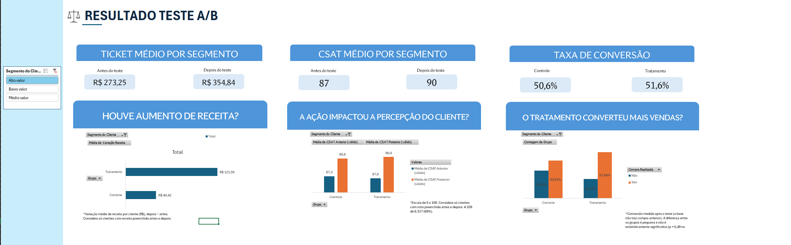

# Análise de Teste A/B: Receita, CSAT e Conversão

Projeto autoral de análise de dados em **Excel** (tabelas dinâmicas, segmentação, fórmulas de teste estatístico e dashboard), feito com uma base sintética do Kaggle. A pergunta central: **uma nova estratégia de negócios gerou ganho real em receita, conversão e satisfação do cliente, ou a diferença é só ruído?**



*Dashboard com o segmento "Alto valor" selecionado. A segmentação controla todos os indicadores.*

## Resumo dos resultados

- **Receita:** o grupo Tratamento teve variação média de receita por cliente de **+R$ 96,0**, contra **+R$ 29,8** no Controle (diferença de **+R$ 66,2**, p < 0,001), com efeito consistente nos três segmentos.
- **CSAT:** sem diferença entre os grupos (+3,7 contra +3,8 pontos; p = 0,73).
- **Conversão:** sem diferença relevante (50,9% contra 50,0%; p = 0,49).
- **Leitura:** a estratégia elevou a receita sem prejudicar a satisfação, e o ganho **não veio de mais compradores**. Hipótese a investigar: ticket maior por cliente.

## Contexto de negócio

Uma empresa (fictícia) testou uma nova estratégia de vendas em parte da base de clientes. Os clientes foram divididos em dois grupos:

- **Controle:** seguiu o processo padrão (referência de comparação).
- **Tratamento:** foi exposto à nova estratégia.

A base traz receita e CSAT **antes e depois** da intervenção, o segmento do cliente (Alto, Médio ou Baixo valor) e se houve compra. A análise apoia a decisão de expandir a estratégia para toda a base ou ajustá-la antes.

## Perguntas de negócio

1. **Houve aumento de receita?** O Tratamento teve um aumento de receita por cliente maior que o Controle, e essa diferença é estatisticamente relevante?
2. **A ação impactou a percepção do cliente?** O CSAT do Tratamento mudou em relação ao Controle?
3. **O tratamento converteu mais vendas?** A proporção de clientes que compraram é diferente entre os grupos?
4. **O efeito muda por segmento?** Os resultados se repetem em Alto, Médio e Baixo valor?

## Dados

- **Fonte:** [Sales and Satisfaction](https://www.kaggle.com/datasets/matinmahmoudi/sales-and-satisfaction), de Matin Mahmoudi (Kaggle). Dataset **sintético**, na versão com valores faltantes (NaN).
- **Tamanho:** 10.000 linhas originais. Foram mantidas **6.317**, as que têm grupo, segmento e compra preenchidos.
- **Variáveis:** grupo, segmento do cliente, receita antes e depois, CSAT antes e depois (escala de 0 a 100) e compra realizada.
- **Valores faltantes:** mantidos como vazios, **sem substituir por zero**. A análise de cada métrica usa só os clientes com valor nos dois momentos: **receita 4.934 de 6.317 (78%)** e **CSAT 4.339 de 6.317 (69%)**.
- **Observação:** os dados não incluem data nem identificador do cliente.

> O arquivo original não está neste repositório. Baixe-o no link do Kaggle e consulte a licença do dataset.

## Como analisei

1. **Tratamento dos dados:** tradução de nomes e categorias, filtro das linhas incompletas e criação de colunas de validade (`Receita Válida`, `CSAT Válido`) e de variação (`Variação Receita`, `Variação CSAT`).
2. **Tabelas dinâmicas** com segmentação por perfil de cliente, alimentando os cartões e gráficos do dashboard.
3. **Comparação entre grupos com antes e depois:** em vez de comparar totais, calculei a **variação por cliente** (depois − antes) e comparei as médias entre Controle e Tratamento. O grupo de controle isola o efeito da estratégia de outros fatores que mudaram no período.
4. **Testes de significância:**
   - Receita e CSAT: teste t com variâncias desiguais (`TESTE.T`, tipo 3), com `FILTRO` para separar grupo e segmento.
   - Conversão: teste qui-quadrado sobre a tabela 2×2 (grupo × compra).
5. **Leitura dos resultados:** considerei p < 0,05 como diferença estatisticamente relevante, e avaliei se o efeito se repete nos segmentos.

## Principais achados

**Receita** (variação média por cliente, em R$, depois − antes; 4.934 clientes):

| Segmento | Controle | Tratamento | Diferença | p |
|---|---|---|---|---|
| Geral | +29,8 | +96,0 | **+66,2** | < 0,001 |
| Alto valor | +40,4 | +121,6 | +81,2 | < 0,001 |
| Médio valor | +30,9 | +98,0 | +67,1 | < 0,001 |
| Baixo valor | +17,4 | +69,5 | +52,1 | < 0,001 |

**CSAT** (variação média em pontos; 4.339 clientes):

| Segmento | Controle | Tratamento | Diferença | p |
|---|---|---|---|---|
| Geral | +3,8 | +3,7 | −0,1 | 0,73 |
| Alto valor | +2,5 | +3,0 | +0,5 | 0,39 |
| Médio valor | +4,8 | +4,5 | −0,3 | 0,57 |
| Baixo valor | +4,0 | +3,6 | −0,4 | 0,29 |

**Conversão** (proporção de compradores após o teste):

| Segmento | Controle | Tratamento | p |
|---|---|---|---|
| Geral | 50,0% | 50,9% | 0,49 |
| Alto valor | 50,6% | 51,6% | 0,64 |
| Médio valor | 48,3% | 50,3% | 0,35 |
| Baixo valor | 51,2% | 50,7% | 0,83 |

## Recomendação

Ampliar o teste de forma **gradual**, monitorando o CSAT e investigando de onde vem o aumento de receita (por exemplo, ticket médio por compra, frequência ou mix de produtos). Antes de expandir para toda a base, **confirmar que os clientes foram alocados aos grupos de forma aleatória**, porque a base não documenta isso.

## Limitações

- Dados sintéticos, então as conclusões são **ilustrativas** e não refletem uma empresa real.
- Sem data nem identificador do cliente: não dá para checar duração do teste, sazonalidade ou clientes repetidos.
- A alocação aleatória entre os grupos não está documentada.
- Receita e CSAT só foram avaliados nos clientes com valor nos dois momentos (78% e 69%).
- A conversão só existe **após** o teste, então a comparação é entre grupos, não antes e depois.
- Os p-valores dos segmentos envolvem vários testes; um valor isolado perto de 0,05 poderia ser acaso.

## Aprendizados

- **Conferir a escala dos dados com a fonte.** Na primeira versão, a importação do CSV no Excel em português perdeu o separador decimal (`240.5483589` virou `2405483589`), e os valores ficaram misturados em escalas diferentes. Isso criou "faltantes" e "valores fora da escala" que não existiam, e levou a uma conclusão errada: de que não havia diferença na receita. Ao revisar o projeto, comparei os valores com a descrição do dataset no Kaggle, reimportei os dados corretamente e refiz toda a análise.
- **Faltante não é zero.** Tratar valores vazios como zero distorce médias e variações.
- **Comparar variações com grupo de controle**, e não totais, evita ler como efeito da estratégia o que é crescimento geral.
- **Testar significância** antes de concluir: diferenças que parecem grandes podem ser ruído, e o contrário também.

## Estrutura do repositório

```
├── README.md
├── analise_teste_ab_vendas_csat.xlsx   # base tratada, cálculos e dashboard
└── prints/
    └── dashboard.png
```

## Como abrir

Abra o arquivo `.xlsx` no Excel 365 ou 2021 (as fórmulas de significância usam `FILTRO`). Na aba **Dashboard**, use a segmentação à esquerda para alternar entre os segmentos. As abas **Base limpa** e **Cálculos** mostram a base tratada, as tabelas dinâmicas e os testes.

## Ferramentas

Excel (Power Query para a importação, tabelas dinâmicas, segmentação, `TESTE.T`, `FILTRO` e `TESTE.QUI`).

## Autora

**Juliana Dantas Piasentin**, [LinkedIn](https://www.linkedin.com/in/juliana-dantas-piasentin/) · [GitHub](https://github.com/julianadpiasentin)
